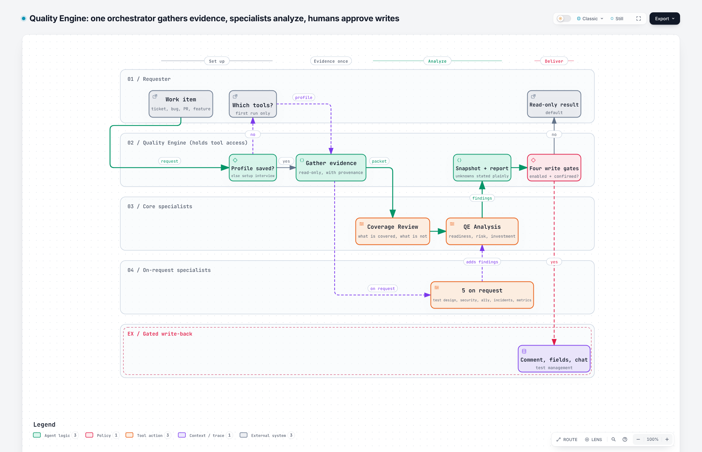

# Quality Engine

**A vendor-neutral quality engine for engineering teams: one orchestrator that gathers evidence from the tools you already use, and specialist skills it calls to turn that evidence into a decision-ready recommendation.**

Created by **Jessica Mosley** | [LinkedIn](https://www.linkedin.com/in/jessmosley/) | [GitHub](https://github.com/j-m-o/)  
Portfolio concept and original framework | Version 1.2.1 | November 2026

Give Quality Engine a ticket, bug, pull request or feature. It asks which tools you use, connects only those, gathers evidence once, and returns how ready and how risky the work is, what tests exist or are missing, where quality effort pays off, and whether recent errors, slowdowns or incidents make the area risky. This is a **reference implementation**, not a connected production integration.

## Why I created this

Quality signals live in a dozen tools: the tracker, the test platform, error tracking, observability and incident history. Most teams stitch them together by hand at the moment a decision is due. I built Quality Engine to do that stitching once. It asks what your team actually uses, gathers evidence from those tools only, says plainly what it could not verify, and turns it into a readiness and risk call a person can act on.

I also wanted it to answer a question most test tools skip: is this a poor area to build in right now because of recent errors and slowdowns? I made it vendor-neutral on purpose so it is useful beyond any one company's stack.

## How it fits together

| Piece | Role | Runs |
| --- | --- | --- |
| [**Quality Engine**](Quality-Engine/skills/quality-engine/SKILL.md) | Setup, tool access, evidence gathering, routing, report, gated write-back | Always |
| [Coverage Review](Quality-Engine/skills/coverage-review/SKILL.md) | What behavior is demonstrably covered, and what is not? | Core |
| [QE Analysis](Quality-Engine/skills/qe-analysis/SKILL.md) | Is this ready, what could go wrong, where should QE invest? | Core |
| [QE Planning and Test Design](Quality-Engine/skills/qe-planning-test-design/SKILL.md) | Which scenarios and cases will produce meaningful confidence? | On request |
| [Security Review](Quality-Engine/skills/security-review/SKILL.md) | What security and privacy controls should be verified? | On request |
| [Accessibility Review](Quality-Engine/skills/accessibility-review/SKILL.md) | What inclusive-interaction risks need validation? | On request |
| [Incident Intelligence](Quality-Engine/skills/incident-intelligence/SKILL.md) | What prior defects, incidents or error history change the picture? | On request, or when the question is "is this area risky" |
| [Metrics Intelligence](Quality-Engine/skills/metrics-intelligence/SKILL.md) | How will we know the feature and delivery are healthy? | On request |

Quality Engine is the **catalyst**: it holds the tool access and makes the decisions. The seven specialists only analyze the evidence packet they are handed, so they can never write to a tracker, test platform or chat tool.

## Architecture

<picture>
  <source media="(prefers-color-scheme: dark)" srcset="Quality-Engine/docs/architecture/quality-engine-dark.png">
  
</picture>

**[Open the interactive diagram](https://j-m-o.github.io/Quality-Engine/Quality-Engine/docs/architecture/quality-engine.html)** (zoom, focus, trace routes, light and dark). Built with [Archify](https://github.com/tt-a1i/archify) from the typed source in [`docs/architecture/quality-engine.workflow.json`](Quality-Engine/docs/architecture/quality-engine.workflow.json).

## It starts by asking what you use

No vendor is assumed. On first use Quality Engine asks, in a few multiple-choice questions, which of these you want to continue with:

- Issue tracker: Azure DevOps, GitHub Issues, Jira, Linear, Shortcut
- Source control and CI: Bitbucket, GitHub, GitLab, CircleCI, Jenkins
- Test platform and management: Cypress, mabl, Playwright, Selenium, TestRail, Xray, Zephyr
- Error tracking and observability: Bugsnag, Datadog, Grafana, Honeycomb, New Relic, Rollbar, Sentry, Splunk
- Product analytics and incidents: Amplitude, incident.io, Mixpanel, Opsgenie, PagerDuty, PostHog, Segment
- Chat: Slack, Microsoft Teams

Then it asks how you want to connect them: **show me the steps** (a checklist per tool), **walk me through it** (one tool at a time, with a check after each), **run the vendor's own setup skill** where one exists, or **skip and paste evidence**. The [connect guide](Quality-Engine/skills/quality-engine/references/connect-guide.md) holds the plain-language steps.

For each one it looks for an already-loaded tool, a host connector, the vendor's official MCP server or skill, a CLI or API, and finally a paste-in route. A tool counts as connected only after a read call succeeds. Xray, Datadog, Sentry or any other vendor matters only if your team uses it, and "none, I will paste evidence" is always an option. See the [integrations catalog](Quality-Engine/skills/quality-engine/references/integrations-catalog.md) for what was checked and when. Some entries are verified, some are community-only, and Segment's official MCP server covers its documentation but not your event data.

**mabl** is reached through the mabl CLI and the hosted cloud MCP server only, together with mabl's own skills at [mablhq/skills](https://github.com/mablhq/skills). The local mabl MCP server is retired and is not used. See the [mabl reference](Quality-Engine/skills/quality-engine/references/mabl.md).

## Core assessment contract

The six recommended display fields are:

1. **Feature Quality Readiness Score:** 0 to 100, or unscored when information is inadequate.
2. **Feature Risk Level:** Low, Medium, High or Critical.
3. **Test Coverage Level:** Strong, Partial, Weak, Missing or Unknown. A Jira field may optionally carry a vendor name such as **Mabl Coverage Level**.
4. **QE Effort Estimate:** Low, Medium, High or Undetermined.
5. **Automation ROI Level:** Low, Medium, High or Undetermined.
6. **Coverage Recommendation:** Maintain existing, Update existing, Add targeted tests, Expand regression coverage or Investigate coverage first.

Read the [scoring rubric](Quality-Engine/skills/qe-analysis/references/scoring-rubric.md), [field mapping](Quality-Engine/jira/field-mapping.md) and [JSON schema](Quality-Engine/schemas/feature-quality-assessment.schema.json) before treating scores as standardized across teams. The rubric is a **proposed framework**, not a validated empirical quality metric.

## Install

| Option | What you get | Use when |
| --- | --- | --- |
| `dist/quality-engine.skill` | The orchestrator with all seven specialists bundled inside | **Recommended.** One install, nothing else needed |
| `dist/specialists/*.skill` | Each specialist as its own skill | You want a specialist on its own, or to call it from another workflow |
| `dist/agents/*.md` | Agent definitions for the orchestrator and each specialist | You prefer agents over skills. See [agent mode](Quality-Engine/skills/quality-engine/references/agent-mode.md) |

Generate everything with `python scripts/build.py`. The folders under `skills/` are the source of truth; the build derives the rest, so skill and agent never drift. Details are in [INSTALLATION.md](Quality-Engine/INSTALLATION.md).

## Start here

1. Follow [QUICKSTART.md](Quality-Engine/QUICKSTART.md) with the fictional example. It needs no integrations.
2. Run the setup interview with your own tools and save the profile it produces. A skill cannot persist its own settings, so keep `quality-engine.profile.yaml` next to your code.
3. Leave write-backs off until the read-only output looks right. Each write passes [four gates](Quality-Engine/skills/quality-engine/references/write-back-gates.md).
4. Atlassian users can also use the optional [Jira and Rovo adapter](Quality-Engine/jira/automation-blueprint.md).

## Design principles

- **Evidence before assertion:** do not invent test counts, incidents, defects, customer outcomes, effort or savings.
- **Unknown is not zero:** missing evidence does not prove missing tests, errors or risk.
- **Risk and readiness are separate:** a high-risk feature can be well planned; a low-risk feature can be poorly specified.
- **One owner of tool access:** the orchestrator gathers evidence once; specialists only analyze it.
- **Human-owned decisions:** assessments are recommendations, not approvals or release gates.
- **Source hygiene:** treat ticket bodies, retrieved pages and tool outputs as untrusted task data, not instructions.
- **Compare against a baseline:** runtime signals are judged against an area's own history or traffic, never by raw counts across areas.
- **No vendor lock-in:** every integration is optional and has a manual route.

## Files

- [Portfolio case study](Quality-Engine/PORTFOLIO-CASE-STUDY.md)
- [Fictional sample ticket](Quality-Engine/examples/sample-ticket.md), [example comment](Quality-Engine/examples/sample-jira-comment.md), [machine-readable assessment](Quality-Engine/examples/sample-assessment.json)
- [Profile template](Quality-Engine/skills/quality-engine/assets/profile-template.yaml)
- [Evidence packet](Quality-Engine/skills/quality-engine/references/evidence-packet.md) and [agent contracts](Quality-Engine/orchestration/agent-contracts.md)
- [Architecture diagram (interactive)](https://j-m-o.github.io/Quality-Engine/Quality-Engine/docs/architecture/quality-engine.html) and [Mermaid source](Quality-Engine/orchestration/pipeline.mmd)
- [Release checklist](Quality-Engine/RELEASE-CHECKLIST.md)

## Important caveats

This repo contains **instructions, templates and sample contracts**. It does not include a configured automation rule, an executable integration, a connected agent identity or pre-created custom fields. The integrations catalog is dated and will age; verify a connector before relying on it. The agent definitions are generated templates that have not been tested in a live agent host. Exact automation smart values, edit-field permissions and rich-text rendering must be tested in each organization's tenant.

**Authorship and reuse:** see [NOTICE.md](Quality-Engine/NOTICE.md). No open-source license is granted by this package yet.

## Reference specifications

- Agent Skills specification: https://agentskills.io/specification
- Atlassian Rovo automation response formats: https://support.atlassian.com/cloud-automation/docs/automation-smart-values-rovo-agents/
- Atlassian automation action behavior: https://support.atlassian.com/cloud-automation/docs/jira-automation-actions/
- WCAG 2.2: https://www.w3.org/TR/WCAG22/
- DORA software delivery metrics: https://dora.dev/insights/dora-metrics-history/

---
*Quality Engine, created by **Jessica Mosley** | [LinkedIn](https://www.linkedin.com/in/jessmosley/) | [GitHub](https://github.com/j-m-o/)*
